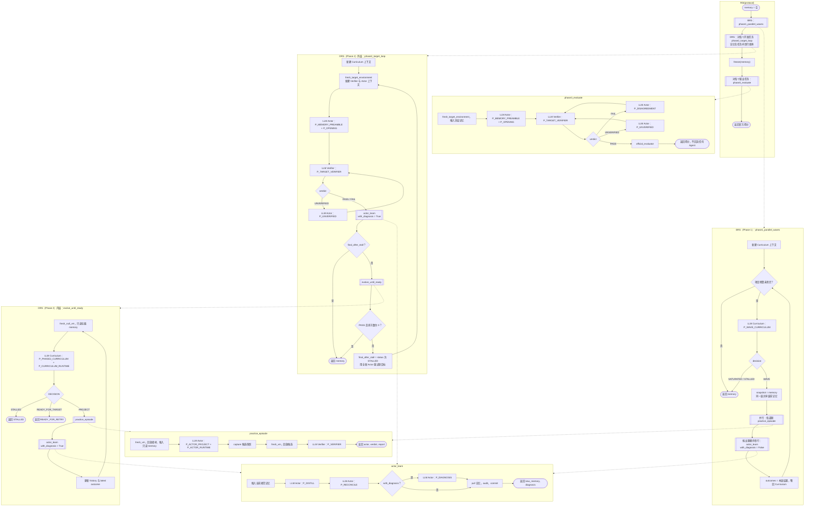

# RSI 过程伪码笔记

本文用伪码描述 RSIAgent 的递归自我改进（RSI）流程，并在每个 LLM 调用处给出实际使用的 prompt 及其所在文件。

- 描述的是默认公开流程：`scripts/run_rsi.sh` → `benchmarks/osworld/pipeline.py` 依次执行 Phase 1 / 2 / 3，Phase 2 使用默认的 `curriculum_review` 停止策略。
- prompt 原文为英文，这里保持原文摘录，`…` 表示省略；完整文本见链接。
- 伪码省略了基础设施细节（VM 重置与回放、断点恢复、审计、哈希校验、事件日志）。

## 1. 角色与"被改进的对象"

| 角色 | 模型（默认配置） | 职责 |
| --- | --- | --- |
| Actor | GLM-5.3（[config/roles/actor.yaml](config/roles/actor.yaml)、[config/roles/target.yaml](config/roles/target.yaml)） | 写程序操作虚拟机完成任务；**唯一**能写持久记忆 `~/.memory` 的角色 |
| Verifier | Kimi K3（[config/roles/verifier.yaml](config/roles/verifier.yaml)、[config/roles/practice_verifier.yaml](config/roles/practice_verifier.yaml)） | 独立检查候选结果，给出 PASS / FAIL / UNVERIFIED；看不到 Actor 的记忆、推理和自述 |
| Curriculum | Kimi K3（[config/roles/curriculum.yaml](config/roles/curriculum.yaml)） | 外层搜索控制器：出练习题、决定何时停止；不判分、不写记忆 |
| Host harness | 代码 | 隔离、落盘、在合法边界提交记忆、最后调用密封的官方评测器 |

模型权重不变。"自我改进"改进的是 **Actor 自己撰写的持久记忆 `memory`**：每次经验（无论 PASS 还是 FAIL）之后，由同一个 Actor 上下文蒸馏进记忆，下一个全新的 Actor 上下文带着它开工。

## 2. 顶层流程

```python
# scripts/run_rsi.sh + benchmarks/osworld/pipeline.py
def RSI(protocol):
    memory = {}                                             # 空记忆起步

    # Phase 1（BRS）：围绕目标分布/目标查询做并行探索练习，积累记忆
    memory = phase1_parallel_waves(protocol.direction, memory, budget=protocol.project_budget)

    # Phase 2（DRS）：逐个开发目标任务做"真实尝试 → 学习 →（针对性练习）→ 重试"
    for task in protocol.development_tasks:
        memory = phase2_target_loop(task, memory)           # 记忆在任务间串行继承

    frozen = freeze(memory)                                  # 冻结，之后只读

    # Phase 3：冻结记忆 + 官方评测器，Curriculum 与记忆更新全部关闭
    return [phase3_evaluate(task, frozen) for task in protocol.held_out_tasks]
```

对应代码：[`execute_phase1`](benchmarks/osworld/pipeline.py#L390)、[`execute_phase2`](benchmarks/osworld/pipeline.py#L432)、[`execute_phase3`](benchmarks/osworld/pipeline.py#L540)。

## 3. 共用子过程

### 3.1 一次练习：Actor 做题 → Verifier 判定

```python
def practice_episode(project, fixtures, memory):
    vm = fresh_vm(); replay(vm, fixtures); push(vm, memory)          # 工作期间 ~/.memory 只读

    actor = new_context()                                            # 全新 Actor 上下文
    handoff = LLM(actor, system=ACTOR_SYSTEM,
                  prompt=P_ACTOR_PROJECT(project, listing(memory)) + P_ACTOR_RUNTIME)
    candidate = capture(vm, "/home/user/evolution_project")          # 逐字节快照候选

    vm = fresh_vm(); replay(vm, candidate)                           # Verifier 只看候选本身
    verifier = new_context()                                         # 全新 Verifier 上下文
    verdict, report = LLM(verifier, system=VERIFIER_SYSTEM,
                          prompt=P_VERIFIER(project))                # PASS/FAIL 为终局，FAIL 不返工
    return actor, verdict, report                                    # actor 上下文保留，用于学习
```

对应代码：[`_execute_branch`](explore/phase1_wave.py#L354)（Phase 1）、[`_run_practice_attempt`](explore/target_learning.py#L257)（Phase 2）。

Phase 2 的练习走 [`run_practice_with_evidence`](explore/practice_evidence_recovery.py#L36)：Verifier 还可以返回 UNVERIFIED，此时同一 Actor 收到 `P_UNVERIFIED(report)` 补充可复现证据后再次送检，直到得到 PASS/FAIL。Phase 1 的分支只有 PASS/FAIL。

### 3.2 学习：同一个 Actor 上下文把经验写进记忆

```python
def actor_learn(actor, verdict, report, memory, with_diagnosis):
    push(vm, memory)                                                 # 换成当前规范记忆
    LLM(actor, prompt=P_DISTILL(verdict, report))                    # ① 蒸馏：改写 ~/.memory（草稿）
    LLM(actor, prompt=P_RECONCILE())                                 # ② 对账：整库一致性核对
    diagnosis = None
    if with_diagnosis:                                               # 仅 Phase 2
        diagnosis = LLM(actor, prompt=P_DIAGNOSIS(verdict, report))  # ③ 给 Curriculum 的因果诊断
    new_memory = pull(vm, "~/.memory")
    assert audit(new_memory)                                         # 泄漏/边界审计，不改内容
    commit(new_memory)                                               # 原子安装 + 日志
    return new_memory, diagnosis
```

对应代码：[`_promote_learning`](explore/target_learning.py#L163)、[`_commit_branch_memory`](explore/phase1_wave.py#L507)。

## 4. Phase 1：Broad Recursive Self-exploration（BRS，并行波次探索）

BRS 是论文对 Phase 1 的称呼：先"广"——并行获取多样经验，整波结束后按序把经验合并进记忆。

```python
# explore/phase1_wave.py: evolve_parallel_phase1
def phase1_parallel_waves(direction, memory, budget):
    curriculum = new_context()                         # 整个 Phase 1 持续同一个 Curriculum 上下文
    outcomes, n_projects = "", 0
    while n_projects < budget:                         # 预算只在完整波次边界检查
        decision = LLM(curriculum,                     # 在 VM 里造好每道题的素材目录，再发布 JSON
                       prompt=P_WAVE_CURRICULUM(direction, outcomes))
        if decision.decision in ("SATURATED", "STALLED"):
            break
        snapshot = memory                              # 同一波所有分支共享同一份波前记忆

        branches = parallel_map(                       # 分支间互不可见
            lambda p: practice_episode(p.instruction, p.fixtures, snapshot),
            decision.projects)
        # 任一分支未得到有效 PASS/FAIL → 整波阻塞，不提交任何记忆

        results = []
        for actor, verdict, report in branches:        # 按出题顺序**串行**提交记忆
            memory, _ = actor_learn(actor, verdict, report, memory, with_diagnosis=False)
            results.append((verdict, report, diff(memory)))
            n_projects += 1
        outcomes = render(decision.rationale, results) # 下一波喂回 Curriculum
    return memory
```

对应代码：[`evolve_parallel_phase1`](explore/phase1_wave.py#L551)。

## 5. Phase 2：Deep Recursive Self-exploration（DRS，目标任务驱动的"尝试—学习—练习—重试"）

DRS 是论文对 Phase 2 的称呼：再"深"——串行地尝试目标任务，由 Curriculum 针对暴露出的缺口选择练习，每条经验先更新记忆再进行下一步。下面两个函数合起来构成 DRS。

```python
# core/self_evolving_loop.py: run_self_evolving_loop（hooks 实现在 benchmarks/osworld/phase2.py）
def phase2_target_loop(task, memory):
    curriculum = new_context()                          # 在该目标谱系内持续
    final_after_stall = False
    while True:
        env = fresh_target_environment(task)            # 干净的真实任务环境
        verifier = new_context()                        # 本次尝试内跨多次复查保持同一上下文
        actor = new_context()

        # --- 目标尝试：Actor 做题，声明 done 时触发 Verifier ---
        LLM(actor, system=ACTOR_SYSTEM,
            prompt=P_MEMORY_PREAMBLE(listing(memory)) + P_OPENING(task.instruction))
        while True:
            verdict, report = LLM(verifier, system=VERIFIER_SYSTEM,
                                  prompt=P_TARGET_VERIFIER(task.instruction))
            if verdict != "UNVERIFIED":
                break
            LLM(actor, prompt=P_UNVERIFIED(report))     # 同一 Actor 补充可复现证据后再次送检
        # FAIL 不在原地返工：按协议直接结束本次尝试，进入学习

        # --- PASS 和 FAIL 都要学习 ---
        memory, diagnosis = actor_learn(actor, verdict, report, memory, with_diagnosis=True)

        if final_after_stall:
            return memory                               # Curriculum 停滞后的最后一次测试，无论结果
        if verdict == "FAIL":
            release(env)

        # --- Curriculum 决定下一个经验 ---
        status, memory, n = evolve_until_ready(task, verdict, report, diagnosis, memory, curriculum)

        if verdict == "PASS" and n == 0:
            return memory                               # 通过且无需再练：正常收敛
        final_after_stall = (status == "STALLED")
        # 否则：做过练习（或 FAIL 后 READY）→ 必须用全新 Actor 重试未改动的目标


# explore/unified_evolution.py: evolve_until_ready
def evolve_until_ready(task, verdict, report, diagnosis, memory, curriculum):
    latest = render(task, report, diagnosis)
    history, n = [], 0
    while True:
        vm = fresh_null_vm(); push(vm, memory)          # Curriculum 只读查看 Actor 记忆
        decision = LLM(curriculum,
                       prompt=P_PHASE2_CURRICULUM(task, history, latest) + P_CURRICULUM_RUNTIME)
        if decision.token == "STALLED":
            return "STALLED", memory, n
        if decision.token == "READY_FOR_TARGET":
            return "READY_FOR_RETRY", memory, n
        # DECISION: PROJECT —— 正文原样作为练习题交给全新 Actor
        fixtures = capture(vm, "/home/user/evolution_project")
        actor, v, r = practice_episode(decision.body, fixtures, memory)
        memory, d = actor_learn(actor, v, r, memory, with_diagnosis=True)
        n += 1
        history.append(f"practice project {n}: {v}")
        latest = render(decision.body, v, r, d)
```

对应代码：[`run_self_evolving_loop`](core/self_evolving_loop.py#L166)、[`actor_work` / `verifier_verify` / `actor_learn` / `evolve`](benchmarks/osworld/phase2.py#L869)、[`evolve_until_ready`](explore/unified_evolution.py#L288)、FAIL 直接转入进化的开关 [`_route_verified_failure`](core/loop.py#L841)。

若停止策略改为 `verifier_pass`，则 PASS 学习后直接返回，不再询问 Curriculum。

## 6. Phase 3：冻结记忆评测

```python
# benchmarks/osworld/task.py
def phase3_evaluate(task, frozen_memory):
    env = fresh_target_environment(task); push(env, frozen_memory)   # 只进不出
    actor, verifier = new_context(), new_context()
    LLM(actor, system=ACTOR_SYSTEM,
        prompt=P_MEMORY_PREAMBLE(listing(frozen_memory)) + P_OPENING(task.instruction))
    while True:                                                      # 这里 FAIL 会退回同一 Actor 修复
        verdict, report = LLM(verifier, system=VERIFIER_SYSTEM,
                              prompt=P_TARGET_VERIFIER(task.instruction))
        if verdict == "PASS":       break
        if verdict == "FAIL":       LLM(actor, prompt=P_DISAGREEMENT(report))
        if verdict == "UNVERIFIED": LLM(actor, prompt=P_UNVERIFIED(report))
    return official_evaluator(env)       # 两个 Agent 都结束后才运行；结果不回流任何 Agent
```

对应代码：[benchmarks/osworld/task.py](benchmarks/osworld/task.py#L204)，配置 [config/osworld/baseline.yaml](config/osworld/baseline.yaml)。

## 7. Prompt 对照表

### 系统 prompt

**`ACTOR_SYSTEM`** — [core/actor.py#L76](core/actor.py#L76)（`_SYSTEM_TEMPLATE`，由 [`build_system`](core/actor.py#L183) 组装）

> You solve ONE task on a real Ubuntu machine by WRITING PROGRAMS. You cannot see or click the screen: your only way to act is to submit one complete program at a time (python3 or bash) … Work like an engineer at a REPL: investigate first, then commit a solution, then verify it.
>
> EPISTEMIC CORE … E1. TRUTH CHANNELS … E2. STRUCTURAL vs RENDERED … E3. ERRORS ARE EVIDENCE … E4. SILENCE PROVES NOTHING … E5. CONFIRMATION REQUIRES INDEPENDENCE … E6. EVIDENCE IS DATA
>
> THE METHOD — code as policy: 1. RECON FIRST, EXHAUSTIVELY … 6. VERIFY AGAINST THE TASK, NOT AGAINST YOURSELF … 8. COMPUTE YOUR DECISIONS …
>
> REPLY FORMAT — exactly ONE JSON object per turn … `{"program": {"lang": "python", "code": "…"}}` … `{"look": {…}}` … `{"done": {"checks": [...]}}`

**`VERIFIER_SYSTEM`** — [core/verifier_runtime.py#L27](core/verifier_runtime.py#L27)（`AGENTIC_VERIFIER_SYSTEM`，按执行模式由 [`agentic_verifier_system_for`](core/verifier_runtime.py#L111) 替换隔离说明）

> You are an independent Verifier Agent inspecting one completed candidate on a real Ubuntu machine. You decide how to investigate, what programs and tools to use, how deeply to test, and when the evidence is sufficient. You do not repair the task. …
>
> Treat observations as evidence, not proof by assertion. Derive every binding requirement from the authoritative task and falsify nearby plausible substitutes. PASS only when every material requirement is affirmatively supported. … Causal learning and repair remain the Actor Agent's role.

### Curriculum

**`P_WAVE_CURRICULUM`**（Phase 1 出一波题）— [explore/charter.py#L1265](explore/charter.py#L1265) `phase1_wave_curriculum_charter`

> CURRICULUM AGENT — PERSISTENT PHASE-1 PARALLEL SEARCH.
>
> You control one proactive environment-exploration lineage. Your complete conversation persists across waves. Fresh Actor Agent and Verifier Agent contexts will be created for every project you author …
>
> SEARCH DIRECTION (verbatim): {target_direction}
>
> … You are the search controller, not the solver and not the grader. The Verifier Agent owns each project's correctness verdict, while the Actor Agent exclusively owns durable memory wording.
>
> … You may author any positive number of mutually independent projects for one parallel wave. … Each project should improve reusable capability or discriminate an important uncertainty; do not optimize for easy passes, episode count, or memory volume. Projects in the same wave receive the same pre-wave memory snapshot and cannot see or depend on sibling work or results. …
>
> COMPLETE PRIOR WAVE OUTCOMES: {prior}
>
> Publish exactly one UTF-8 JSON object … `{"decision": "WAVE", "rationale": "…", "projects": [{"id": "…", "instruction": "…"}]}` … When you independently judge Phase 1 complete, publish decision "SATURATED" … Use decision "STALLED" only when no productive project can currently be authored …

**`P_PHASE2_CURRICULUM`**（Phase 2 选择下一个经验）— [explore/charter.py#L242](explore/charter.py#L242) `self_evolving_curriculum_charter(phase2_outcome=True)`，后接 **`P_CURRICULUM_RUNTIME`** — [explore/practice_loop.py#L460](explore/practice_loop.py#L460)

> CURRICULUM AGENT — PERSISTENT OUTER-LOOP META-SEARCH.
>
> You are the Curriculum Agent for one self-evolving lineage. Your context persists across the lineage … Fresh Actor Agent and Verifier Agent contexts are created at each project boundary; they do not inherit your private reasoning.
>
> PHASE-2 TARGET QUERY — exact natural-language learning direction: {target_direction}
>
> The immutable target query, its complete grounded Verifier Agent PASS or FAIL report, and the same target Actor Agent's learning diagnosis are the target-specific evidence available to you. … You have not been given the official evaluator, hidden checks, graded solution, score, or evaluator trajectory. …
>
> You are the outer-loop search controller, not the solver and not the grader. Maintain and revise hypotheses about the Actor Agent's actual bottleneck. Treat each project as an experiment … When evidence contradicts your theory, change the theory. … After PASS, do not create practice by default: choose PROJECT only when a contrast or stress case can test an important uncertain or overgeneralized hypothesis. After FAIL, prefer practice that discriminates among plausible capability gaps. …
>
> PROJECT HISTORY AND OUTCOMES: {history} / LATEST ROLE-OWNED LEARNING OUTCOME: {outcome} / YOUR PRIVATE SEARCH NOTES: {notes}
>
> CURRENT ACTOR-OWNED DURABLE MEMORY is available at ~/.memory as a disposable evidence copy. … Do not edit, rewrite, approve, reject, or grade the memory …
>
> Choose the next outer-loop action and write the complete handoff to {handoff_path}. Its first non-empty line must be exactly one of: `DECISION: PROJECT` / `DECISION: READY_FOR_TARGET` / `DECISION: STALLED`
>
> For PROJECT, everything after that line is passed verbatim to a fresh Actor Agent as its project. Write a self-contained natural-language request stating WHAT must be true at the end … Do not include your private hypothesis or rationale, implementation advice, a proposed solution, grading logic …
>
> … READY_FOR_TARGET means only that no additional learning experience currently has greater expected value than returning control to the unchanged target lifecycle. …

### Actor：做题

**`P_ACTOR_PROJECT`**（练习题）— [explore/charter.py#L590](explore/charter.py#L590) `self_evolving_actor_charter`，后接 **`P_ACTOR_RUNTIME`** — [explore/practice_loop.py#L484](explore/practice_loop.py#L484)

> ACTOR AGENT — NEW PROJECT.
>
> You are a fresh Actor Agent context for this project. Your durable memory from earlier projects is available at ~/.memory; it may be useful, wrong, outdated, or irrelevant, so decide what to inspect and verify it against the live environment. …
>
> DURABLE MEMORY FILES: {listing} / PROJECT — the Curriculum Agent's natural-language handoff, verbatim: {project}
>
> Code is your control channel, not a reinterpretation of the project … Solve the project using your own judgment … You choose the strategy, investigation, amount of work, and when to stop. …
>
> The Verifier Agent, not you or the harness, decides correctness. When you decide to stop project work, write one complete lossless handoff to {handoff_path}. Put STATUS: SUBMIT on its first non-empty line … SUBMIT is neutral: it claims neither success nor failure …
>
> This episode has one Actor Agent work phase and one Verifier Agent verdict; there is no same-project repair or re-verification cycle. Do not update durable memory during project work. …

**`P_MEMORY_PREAMBLE`**（目标任务/评测时附带记忆清单）— [explore/charter.py#L10](explore/charter.py#L10) `memory_preamble`

> [YOUR MEMORY — notes from your own prior practice in this environment. They may be wrong, outdated, or inapplicable to this task: treat them as hints and verify against the live environment. They are available under ~/.memory/ … any local work-phase edits are discarded and cannot update durable memory. The complete file inventory is below. … First understand the task, then inspect memory as you judge useful … You decide what to retrieve and how to use it.]

**`P_OPENING`**（目标任务开场）— [core/actor.py#L447](core/actor.py#L447) `opening_message`

> TASK: {instruction}
>
> You are at a fresh shell on the machine where this task must be done. Nothing has been examined yet. Decide how much work the task requires and declare done only when you judge its end state ready. Begin your reply with one line 'PLAN: <your phases>' — revise it in later replies whenever reality disagrees with it — then give your first program (reconnaissance).

### Verifier

**`P_VERIFIER`** / **`P_TARGET_VERIFIER`** — [explore/charter.py#L803](explore/charter.py#L803) `agent_harness_verifier_charter`，由 [`verify_agentic`](core/verifier.py#L841) 调用。Phase 1 练习只允许 PASS/FAIL；Phase 2 的练习与目标任务、Phase 3 额外允许 UNVERIFIED（下面摘录的是含 UNVERIFIED 的版本）。

> VERIFIER AGENT — STAGE: CANDIDATE_VERIFICATION.
>
> You are the one Verifier Agent for an Actor Agent <-> Verifier Agent project. Your context persists when the Actor Agent revises the candidate … Each inspection concerns the current live candidate, so prior evidence remains useful but does not prove that a later revision is correct. …
>
> AUTHORITATIVE TASK — verbatim: {task}
>
> The Actor Agent's self-checks, conclusions, handoff narrative, and private reasoning are deliberately not disclosed: discover the candidate through independent observations. You decide what to test and when the evidence is enough. …
>
> For every material requirement, use evidence that distinguishes the required result from a nearby plausible but incorrect substitute. If the available evidence would also approve that substitute, keep investigating through a distinguishing channel. …
>
> You are a full investigation Agent with code-as-policy freedom inside a transactional mirror of the exact live Actor machine. … The harness restores that checkpoint before grading, so none of your in-VM effects enter the scored candidate. …
>
> - PASS only when every material requirement is affirmatively supported.
> - FAIL when concrete evidence establishes a material violation.
> - UNVERIFIED when a material claim remains unresolved after investigation …
>
> When ready, publish your complete lossless report with: `{"program":{"lang":"verifier-report","code":"<your complete report>"}}` … Include exactly one standalone line … VERDICT: PASS, VERDICT: FAIL, or VERDICT: UNVERIFIED.

### Actor：收到 Verifier 反馈

**`P_UNVERIFIED`** — [core/verifier.py#L1701](core/verifier.py#L1701) `unverified_message`

> An INDEPENDENT INSPECTION could not CONFIRM the task is complete — it did not find it wrong; it could not gather enough evidence either way. What it could not confirm: {findings}
>
> DEMONSTRATE the unconfirmed parts through an INDEPENDENT CHANNEL the inspection can re-run from the machine itself … Evidence the WORLD produces — a file you author about your own work proves nothing and will not count. Then declare done again …

**`P_DISAGREEMENT`**（仅 Phase 3 的原地修复）— [core/verifier.py#L1684](core/verifier.py#L1684) `disagreement_message`

> An INDEPENDENT INSPECTION of the machine state (performed without seeing your work or assumptions) found concrete evidence that the task is NOT complete. Its findings: {findings}
>
> Reconcile these findings with your own evidence … fix what is actually wrong, then declare done again.

### Actor：学习（RSI 的核心三步）

**`P_DISTILL`** — [explore/charter.py#L1164](explore/charter.py#L1164) `self_evolving_actor_memory_distillation_msg`

> ACTOR AGENT — FINAL MEMORY DISTILLATION.
>
> This is the terminal learning turn for the project in your same Actor Agent context. The terminal outcome is {outcome}. …
>
> FINAL VERIFIER AGENT REPORT — verbatim: {verifier_report}
>
> Review the complete experience available in your context … The Verifier Agent establishes what was or was not verified; it does not establish why your approach succeeded or failed. Make causal claims only when your trajectory and evidence support them, and preserve uncertainty where they do not.
>
> Update your durable memory at ~/.memory in whatever way you judge will make a fresh future Actor Agent more capable. … you may add, revise, reorganize, delete, or leave memory unchanged. You own the content, representation, retrieval strategy, scope, and stopping decision; there is no required schema, length, number of files, or number of turns. A FAIL may still contain valuable evidence, but must not be recorded as a verified success. …

**`P_RECONCILE`** — [explore/charter.py#L1205](explore/charter.py#L1205) `self_evolving_actor_memory_reconciliation_msg`

> ACTOR AGENT — TERMINAL MEMORY RECONCILIATION.
>
> Your first-pass memory update is a draft and has not been promoted. …
>
> Inventory the complete current durable-memory tree at ~/.memory and inspect every claim-bearing file. Reconcile the corpus as a whole against the trajectory and final Verifier evidence already in context. Look for conflicting assertions, unsupported causal explanations, stale environment assumptions, and conclusions broader than the observed evidence. … Do not merely append this episode while leaving contradicted older advice stated as fact. …
>
> Neither the Verifier Agent nor Curriculum Agent grades the memory. Declare done when the complete memory you choose to carry forward is internally reconciled and ready.

**`P_DIAGNOSIS`**（仅 Phase 2，交给 Curriculum）— [explore/charter.py#L1232](explore/charter.py#L1232) `self_evolving_actor_learning_diagnosis_msg`

> ACTOR AGENT — FREE-FORM LEARNING DIAGNOSIS.
>
> The terminal Verifier outcome is {outcome}. …
>
> Write a complete free-form learning diagnosis to ~/learning_diagnosis.md. This is a role-owned handoff to the persistent Curriculum Agent, separate from durable memory. Explain the hypotheses that now seem most useful for choosing the next experience: attempted approaches, observed limitations, plausible causal reasons, what appears reliable, what remains uncertain, and which distinctions or stress cases could discriminate among competing explanations.
>
> The Verifier establishes what was or was not verified; do not convert its verdict into an unsupported causal story. …

## 8. 备注

- **信息隔离是闭环成立的前提**：Verifier 看不到 Actor 的记忆、自述与推理；Curriculum 看不到候选结果与官方评测；官方评测结果不回流到任何学习阶段。
- **谁对什么负责**：正确性只由 Verifier 判定；记忆内容只由 Actor 撰写；Curriculum 只选"下一个经验"。Harness 的 `audit` 只做边界/泄漏检查，不改写记忆。
- **默认流程未使用的 prompt**：[`unified_curriculum_route_charter`](explore/charter.py#L167)（FAIL 后由 Curriculum 选 REVISE/EVOLVE）、[`unified_curriculum_pass_charter`](explore/charter.py#L80)（PASS 后选 HANDOFF/VERIFY_MORE）、[`self_evolving_target_actor_charter`](explore/charter.py#L643)、[`agent_harness_verifier_orientation_charter`](explore/charter.py#L732)（Verifier 预先熟悉环境，`verifier_stage_lifecycle: false` 时关闭）以及旧版 [`self_evolving_verifier_charter`](explore/charter.py#L1060)。默认 Phase 2 中，目标 FAIL 由协议直接转入进化，不经过 Curriculum 路由。

## 9. 流程图

下图包含上面伪码中的全部 7 个函数。实线是函数内部的控制流，虚线表示"调用该函数"；双边框节点是函数调用，圆角节点是函数的起点或返回。


